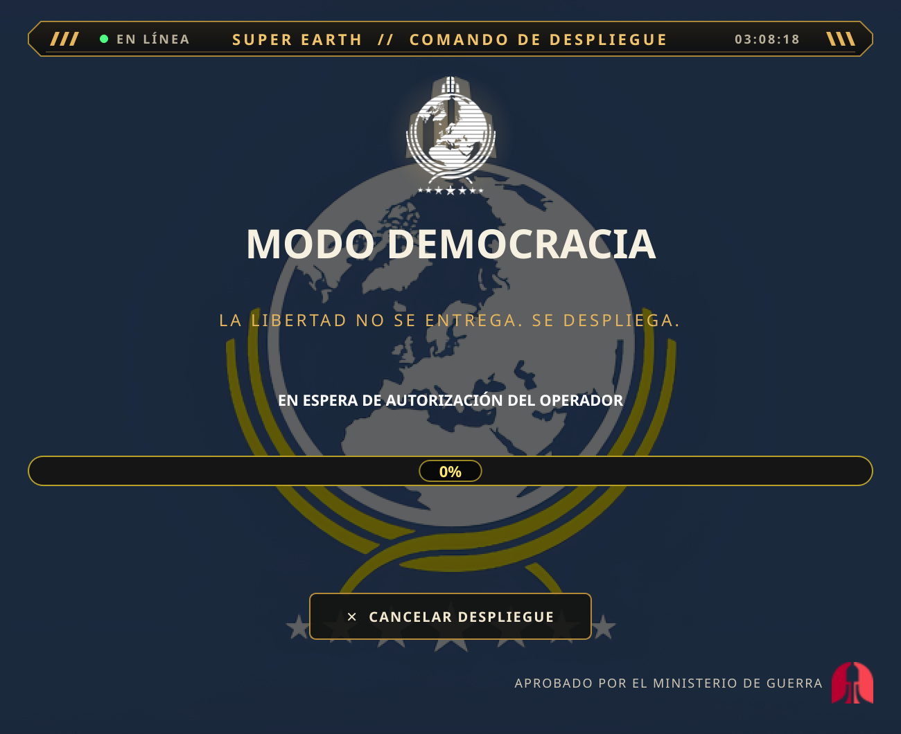
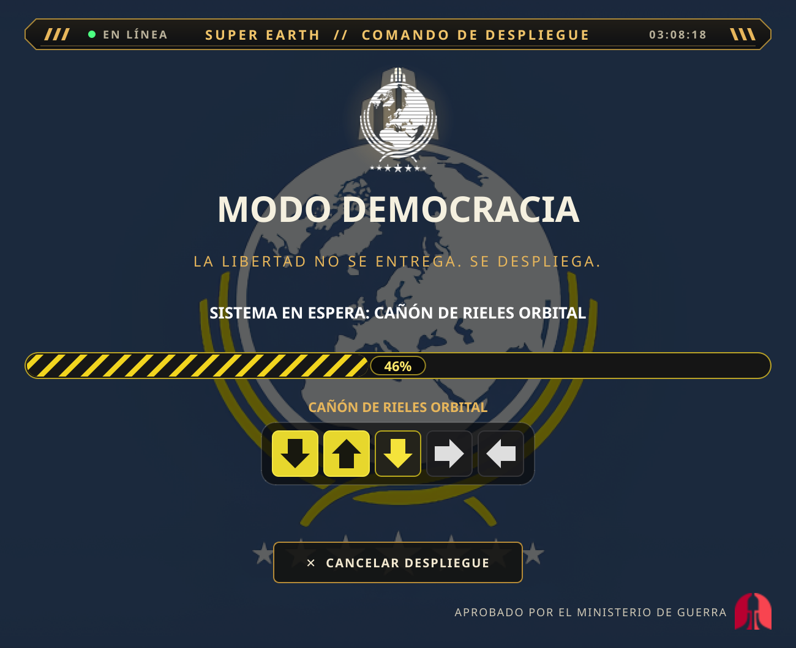
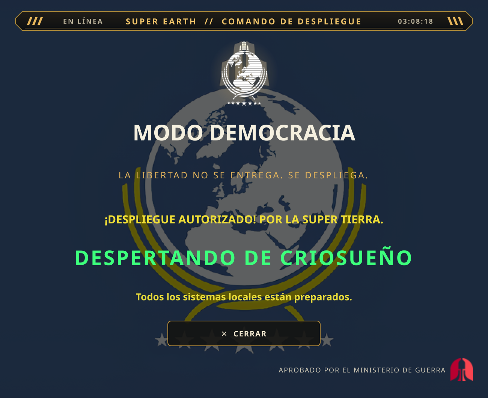

<p align="center">
  
</p>

<h1 align="center">MODO DEMOCRACIA</h1>

<p align="center">
  <strong>PROTOCOLO DE DESPLIEGUE CIUDADANO // COMANDO DE SUPER TIERRA</strong><br>
  <em>«La libertad no se entrega. Se despliega.»</em>
</p>

> **TRANSMISIÓN PRIORITARIA // MINISTERIO DE LA VERDAD**<br>
> Ciudadano: tu escritorio ha sido seleccionado para un despliegue de
> Libertad Gestionada. Mantén la calma, no mires directamente al sol y
> asegúrate de que el micrófono esté conectado.

**Modo Democracia** es un protocolo de escritorio local inspirado en
*Helldivers 2*. Escucha la frase **«Modo Democracia»**, activa una secuencia de
despliegue con música y estratagemas, cambia temporalmente el fondo del
escritorio y, si se configura, abre Helldivers 2 mediante Steam.

El Alto Mando ha autorizado que el protocolo continúe incluso cuando la voz, el
fondo o el audio no estén disponibles: la aplicación informa de la incidencia y
mantiene el resto operativo. Ninguna instalación se realiza sin una orden
explícita.

<sub>Proyecto de fan no oficial, sin relación con Arrowhead Game Studios ni Sony. Los recursos de Helldivers 2 pertenecen a sus respectivos titulares.</sub>

## Informe de situación

El Alto Mando no acepta propaganda: esta tabla separa lo verificado de lo que
aún requiere hardware real.

| Plataforma / función | Estado |
|---|---|
| Linux + KDE Plasma 6 (CachyOS) | **Verificado** con Plasma 6 y `plasma-apply-wallpaperimage`. |
| Fondo en otros escritorios Linux | No implementado; la función se desactiva. |
| Reconocimiento de voz en Linux | Implementado y probado con dispositivos simulados; **la frase con micrófono real sigue pendiente**. |
| Inicio automático en Linux | Implementado; probado con un HOME temporal. **Falta comprobar el inicio real al cerrar y abrir sesión.** |
| Windows y macOS | Implementados, **no probados en hardware real**. |
| Secuencia, audio, bandeja y Steam | Implementados; audio y apertura de Steam pendientes de comprobación manual. |

No debe interpretarse que Windows o macOS están soportados solo porque su
código exista. Consulta [`docs/PLATFORMS.md`](docs/PLATFORMS.md) y
[`docs/TESTING.md`](docs/TESTING.md).

## Capacidades del protocolo

- Activación local por voz con Vosk; no se envía audio a servicios en la nube.
- Interfaz cinematográfica con barra de progreso, animaciones y minijuego de
  estratagemas.
- Música local con desvanecimiento al abrir el juego.
- Cambio opcional del fondo de escritorio y restauración controlada.
- Icono persistente en la bandeja del sistema.
- Inicio automático opcional, oculto en la bandeja.
- Lanzamiento opcional de Helldivers 2 mediante Steam.

## Registro visual del despliegue

<p align="center">
  
  
  
</p>

<p align="center">
  <sub><strong>Espera:</strong> el operador aguarda la orden. ·
  <strong>Estratagema:</strong> la secuencia exige precisión. ·
  <strong>Despliegue:</strong> la libertad ha sido autorizada.</sub>
</p>

Las capturas se generaron desde la interfaz real. La portada y los recursos
visuales están en `Assets/` y `docs/screenshots/`.

## Instalación rápida

Requisitos: Python **3.11+**, PySide6 y, para el fondo, Linux con KDE Plasma 6.
La guía detallada para Fish, Windows, macOS y voz está en
[`Troubleshooting.md`](Troubleshooting.md).

```sh
git clone https://github.com/D0Nv3rg4x/SuperEarthCommand.git
cd SuperEarthCommand
python3 -m venv .venv
source .venv/bin/activate
python -m pip install -r requirements.txt
python -u app.py
```

En Fish, sustituye la activación por `source .venv/bin/activate.fish`.

La voz es opcional:

```sh
python -m pip install -r requirements-voice.txt
bash scripts/instalar_modelo_voz.sh
```

Si no quieres usar voz, pon `enabled = false` en `[voice]`. La aplicación y la
bandeja siguen funcionando, pero la secuencia no se inicia hasta que la voz
vuelva a estar disponible. No se versionan `.venv/` ni `models/`.

## Uso

1. Di **«Modo Democracia»**. No hay un botón alternativo de inicio.
2. La aplicación cambia el fondo si está permitido, reproduce la música e
   inicia la barra de progreso.
3. Pulsa las flechas de cada estratagema. Un error reinicia esa estratagema,
   pero no detiene la barra principal.
4. Al terminar aparece «DESPERTANDO DE CRIOSUEÑO»; si está activado, Steam abre
   Helldivers 2 y la música se desvanece.

Controles:

- **Esc** o **CANCELAR DESPLIEGUE**: cancela, restaura el fondo y oculta la ventana.
- **X**: oculta la ventana; la escucha por voz continúa.
- **Bandeja del sistema**: muestra la ventana o permite salir completamente.

## Configuración esencial

La configuración vive en `config.toml`. Estas son las claves que más se usan:

| Clave | Efecto |
|---|---|
| `[general] activation_phrase` | Frase de activación; si está vacía, la voz se desactiva. |
| `[voice] enabled` | Activa o desactiva el micrófono. |
| `[sequence] wallpaper_enabled` | Permite cambiar el fondo temporalmente. |
| `[sequence] launch_game_after_sequence` + `[steam] launch_enabled` | Ambos deben ser `true` para abrir el juego. |

Las tablas completas y las combinaciones para desactivar funciones están en
[`Troubleshooting.md`](Troubleshooting.md).

## Inicio automático

Es opcional y nunca se activa solo. En Linux, con el entorno virtual activado:

```sh
python -m core.autostart install
python -m core.autostart status
```

Para retirarlo: `python -m core.autostart uninstall`. Consulta
[`docs/AUTOSTART.md`](docs/AUTOSTART.md) para Windows, macOS y la resolución de
problemas.

## Pruebas

La batería automatizada tiene **97 pruebas**:

```sh
bash scripts/ejecutar_pruebas.sh
```

Las comprobaciones que necesitan hardware real —micrófono, audio, fondo visible,
Steam, bandeja y autostart tras cerrar sesión— están en
[`docs/TESTING.md`](docs/TESTING.md).

## Documentación

- [`Troubleshooting.md`](Troubleshooting.md): instalación detallada,
  configuración completa y resolución de problemas.
- [`docs/ARCHITECTURE.md`](docs/ARCHITECTURE.md): módulos y flujo de arranque.
- [`docs/PLATFORMS.md`](docs/PLATFORMS.md): compatibilidad y limitaciones.
- [`docs/AUTOSTART.md`](docs/AUTOSTART.md): inicio automático por plataforma.
- [`docs/TESTING.md`](docs/TESTING.md): pruebas y comprobaciones manuales.
- [`Plan_Desarrollo_Modo_Democracia.md`](Plan_Desarrollo_Modo_Democracia.md):
  plan de desarrollo y estado de las fases.
