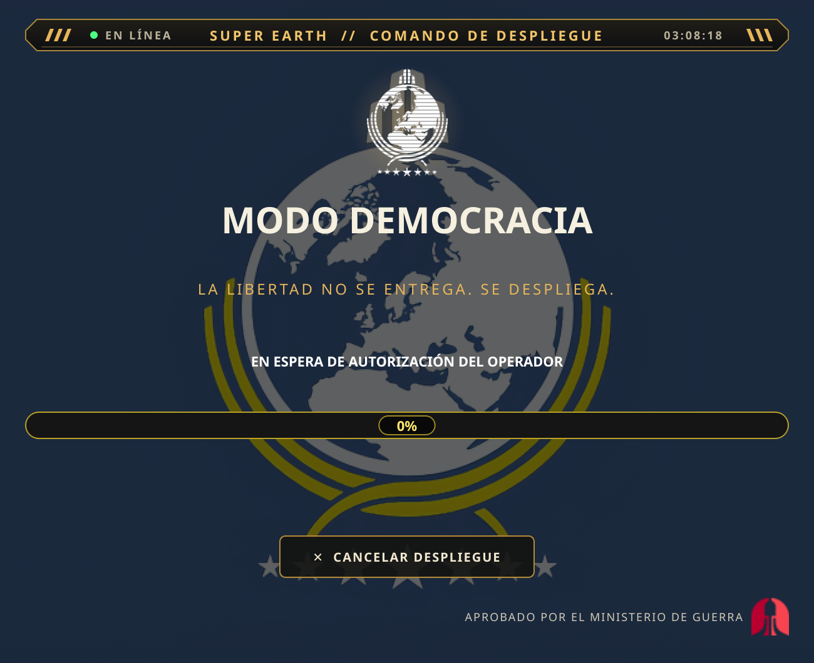
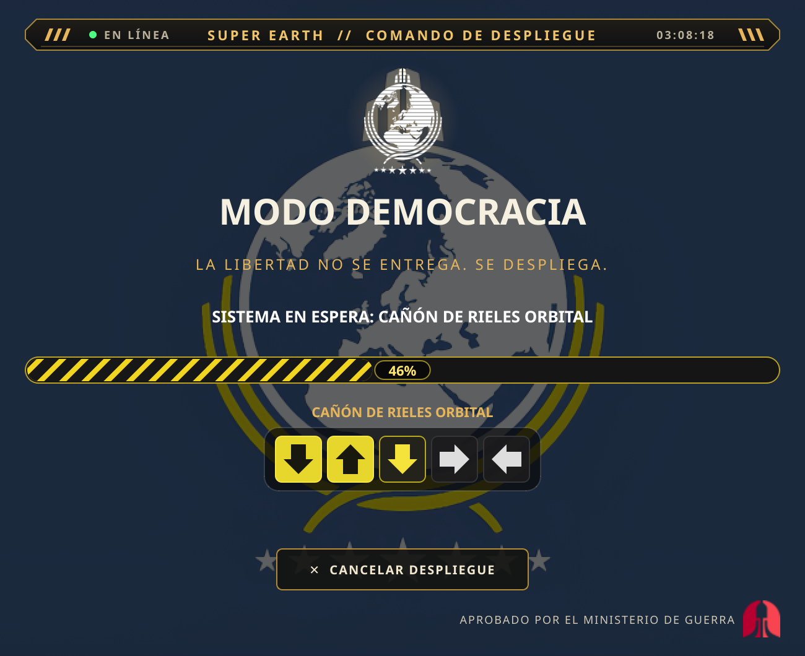
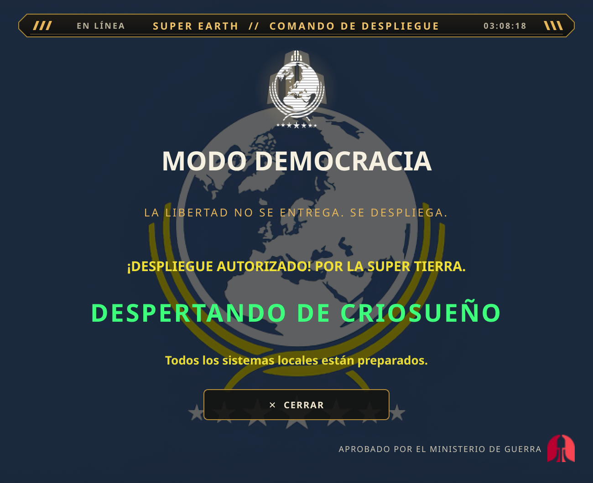

<p align="center">
  <sub><strong>Idioma / Language:</strong>
  <a href="README_es.md">Español</a> ·
  <a href="README_en.md">English</a> ·
  <a href="../../README.md">Main page</a></sub>
</p>

<p align="center">
  
</p>

<h1 align="center">DEMOCRACY MODE</h1>

<p align="center">
  <strong>CITIZEN DEPLOYMENT PROTOCOL // SUPER EARTH COMMAND</strong><br>
  <em>“Freedom isn't given. It's deployed.”</em>
</p>

> **PRIORITY TRANSMISSION // MINISTRY OF TRUTH**<br>
> Citizen: your desktop has been selected for a Managed Liberty deployment.
> Remain calm and make sure your microphone is connected.

**Democracy Mode** is a local desktop protocol inspired by *Helldivers 2*. It
listens for the phrase **“democracy mode”**, starts a deployment sequence with
music and stratagems, temporarily changes the desktop wallpaper and, if
configured, launches Helldivers 2 through Steam.

Voice, wallpaper and audio are optional: if they fail, the application reports
the problem and keeps everything else running. It never installs dependencies,
downloads models, or changes the desktop or autostart without an explicit
command.

<sub>Unofficial fan project, not affiliated with Arrowhead Game Studios or
Sony. Helldivers 2 assets belong to their respective owners.</sub>

## Situation report

| Platform / feature | Status |
|---|---|
| Linux + KDE Plasma 6 (CachyOS) | **Verified** with Plasma 6 and `plasma-apply-wallpaperimage`. |
| Other Linux desktops | Not implemented; wallpaper changes are disabled. |
| Spanish voice | Implemented and tested with simulated devices; **the real microphone phrase is still pending**. |
| English voice | Implemented; requires the English Vosk model. **Real microphone test pending**. |
| Linux autostart | Implemented and tested with a temporary HOME; real login startup still needs a manual check. |
| Windows and macOS | Implemented, **not tested on real hardware**. |
| Audio, tray and Steam | Implemented; audio playback and Steam launch need manual verification. |

See [`docs/PLATFORMS.md`](../../docs/PLATFORMS.md) and
[`docs/TESTING.md`](../../docs/TESTING.md) for details.

## Features

- Local voice activation with Vosk; no audio is sent to the cloud.
- Interface, tray, notices and voice in **Spanish and English**.
- Cinematic sequence with a progress bar and a stratagem minigame.
- Local music that fades out when the game launches.
- Optional desktop wallpaper change and controlled restore.
- Persistent system tray icon and optional autostart.
- Optional Helldivers 2 launch through Steam.

## Visual log

<p align="center">
  
  
  
</p>

The screenshots were captured from the real interface.

## Quick install

Requirements: Python **3.11+**, PySide6 and, for wallpaper changes, Linux with
KDE Plasma 6.

```sh
git clone https://github.com/D0Nv3rg4x/SuperEarthCommand.git
cd SuperEarthCommand
python3 -m venv .venv
source .venv/bin/activate
python -m pip install -r requirements.txt
python -u app.py
```

On Fish, use `source .venv/bin/activate.fish`.

Voice is optional:

```sh
python -m pip install -r requirements-voice.txt
bash scripts/instalar_modelo_voz.sh en
```

Detailed installation for Windows, macOS and other languages:
[`Troubleshooting.md`](../../Troubleshooting.md).

## Usage

1. Say **“democracy mode”**. There is no alternative start button.
2. The application changes the wallpaper if allowed, plays the music and
   starts the progress bar.
3. Press the arrows for each stratagem. A mistake resets that stratagem but does
   not stop the main progress bar.
4. When it finishes, “WAKING FROM CRYOSLEEP” appears; if enabled, Steam launches
   Helldivers 2 and the music fades out.

Controls:

- **Esc** or **CANCEL DEPLOYMENT**: cancels, restores the wallpaper and hides
  the window.
- **X**: hides the window; voice listening continues.
- **System tray**: shows the window or exits the application.

## Languages

The project includes Spanish (`es`) and English (`en`):

```toml
[general]
language = "en"   # "es" for Spanish, "auto" to follow the system
```

The language is applied on restart and also changes the default activation
phrase: `modo democracia` / `democracy mode`. For English voice, install its
model:

```sh
bash scripts/instalar_modelo_voz.sh en
```

Details and the guide for adding languages are in
[`Troubleshooting.md`](../../Troubleshooting.md#idiomas) (Spanish).

## Documentation

- [`Troubleshooting.md`](../../Troubleshooting.md): installation, configuration
  and troubleshooting.
- [`docs/ARCHITECTURE.md`](../../docs/ARCHITECTURE.md): modules and flow.
- [`docs/PLATFORMS.md`](../../docs/PLATFORMS.md): compatibility.
- [`docs/AUTOSTART.md`](../../docs/AUTOSTART.md): autostart.
- [`docs/TESTING.md`](../../docs/TESTING.md): tests and manual checks.
- [`README_es.md`](README_es.md): versión en español.
