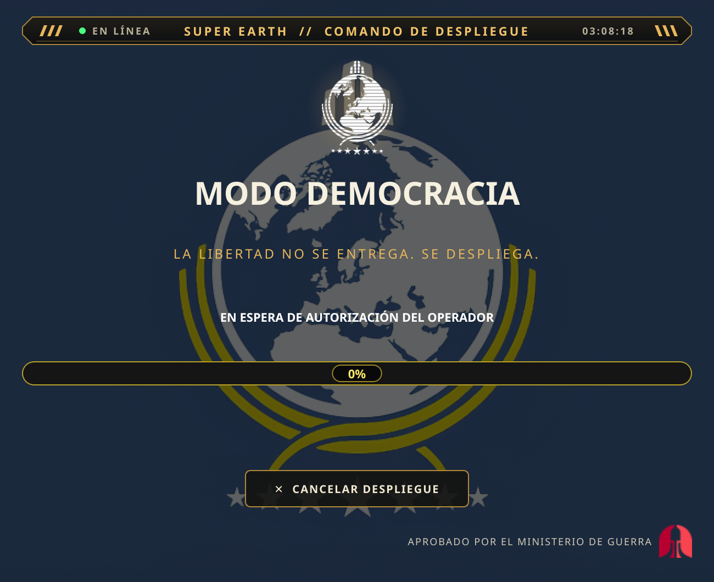
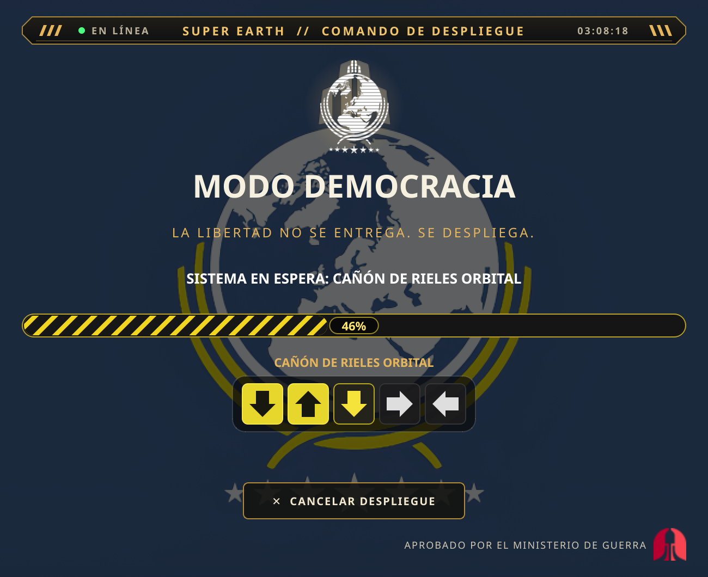
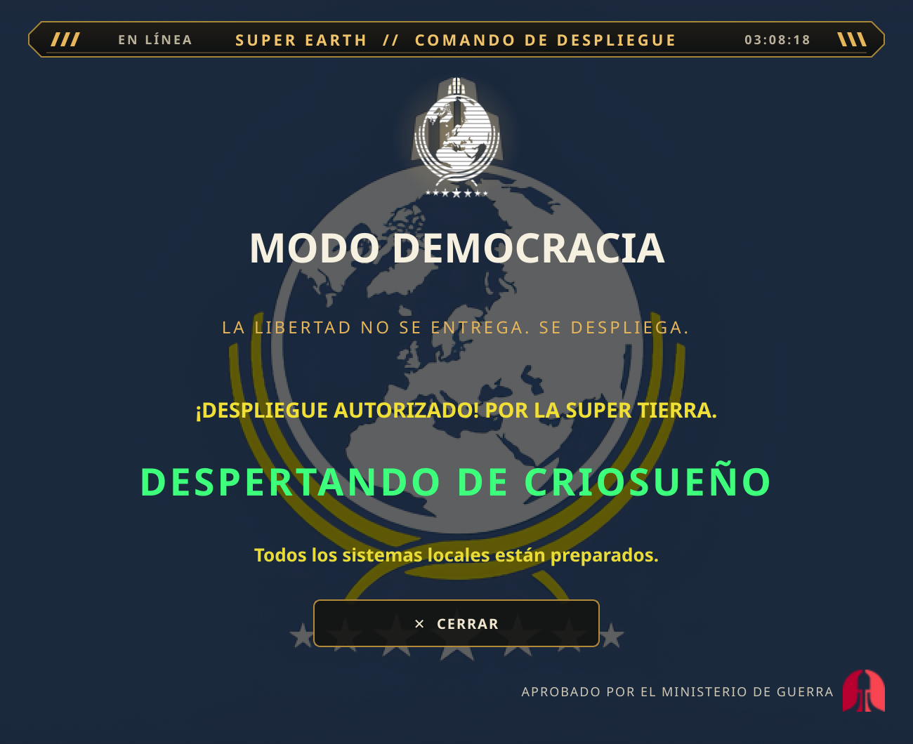

<p align="center">
  <sub><strong>Idioma / Language:</strong>
  <a href="README_es.md">Español</a> ·
  <a href="README_en.md">English</a> ·
  <a href="../../README.md">Portada principal</a></sub>
</p>

<p align="center">
  
</p>

<h1 align="center">MODO DEMOCRACIA</h1>

<p align="center">
  <strong>PROTOCOLO DE DESPLIEGUE CIUDADANO // COMANDO DE SUPER TIERRA</strong><br>
  <em>«La libertad no se entrega. Se despliega.»</em>
</p>

> **TRANSMISIÓN PRIORITARIA // MINISTERIO DE LA VERDAD**<br>
> Ciudadano: tu escritorio ha sido seleccionado para un despliegue de
> Libertad Gestionada. Mantén la calma y asegúrate de que el micrófono esté
> conectado.

**Modo Democracia** es un protocolo de escritorio local inspirado en
*Helldivers 2*. Escucha la frase **«Modo Democracia»**, activa una secuencia de
despliegue con música y estratagemas, cambia temporalmente el fondo del
escritorio y, si se configura, abre Helldivers 2 mediante Steam.

La voz, el fondo y el audio son opcionales: si fallan, la aplicación lo informa
y mantiene el resto operativo. Nunca instala dependencias, descarga modelos ni
modifica el escritorio o el inicio automático sin una orden explícita.

<sub>Proyecto de fan no oficial, sin relación con Arrowhead Game Studios ni
Sony. Los recursos de Helldivers 2 pertenecen a sus respectivos titulares.</sub>

## Informe de situación

| Plataforma / función | Estado |
|---|---|
| Linux + KDE Plasma 6 (CachyOS) | **Verificado** con Plasma 6 y `plasma-apply-wallpaperimage`. |
| Otros escritorios Linux | No implementado; el cambio de fondo se desactiva. |
| Voz en español | Implementada y probada con dispositivos simulados; **la frase con micrófono real sigue pendiente**. |
| Voz en inglés | Implementada; requiere el modelo inglés de Vosk. **Pendiente de prueba con micrófono real**. |
| Inicio automático Linux | Implementado y probado con un HOME temporal; falta el inicio real tras cerrar sesión. |
| Windows y macOS | Implementados, **no probados en hardware real**. |
| Audio, bandeja y Steam | Implementados; audio y apertura de Steam pendientes de comprobación manual. |

Consulta [`docs/PLATFORMS.md`](../../docs/PLATFORMS.md) y
[`docs/TESTING.md`](../../docs/TESTING.md) para el detalle.

## Capacidades

- Activación local por voz con Vosk; no se envía audio a la nube.
- Interfaz, bandeja, avisos y voz en **español e inglés**.
- Secuencia cinematográfica con barra de progreso y minijuego de estratagemas.
- Música local con desvanecimiento al abrir el juego.
- Cambio opcional del fondo de escritorio y restauración controlada.
- Icono persistente en la bandeja e inicio automático opcional.
- Lanzamiento opcional de Helldivers 2 mediante Steam.

## Registro visual

<p align="center">
  
  
  
</p>

Las capturas se generaron desde la interfaz real.

## Instalación rápida

Requisitos: Python **3.11+**, PySide6 y, para el fondo, Linux con KDE Plasma 6.

```sh
git clone https://github.com/D0Nv3rg4x/SuperEarthCommand.git
cd SuperEarthCommand
python3 -m venv .venv
source .venv/bin/activate
python -m pip install -r requirements.txt
python -u app.py
```

En Fish, usa `source .venv/bin/activate.fish`.

La voz es opcional:

```sh
python -m pip install -r requirements-voice.txt
bash scripts/instalar_modelo_voz.sh es
```

Instalación detallada para Windows, macOS y otros idiomas:
[`Troubleshooting.md`](../../Troubleshooting.md).

## Uso

1. Di **«Modo Democracia»**. No hay un botón alternativo de inicio.
2. La aplicación cambia el fondo si está permitido, reproduce la música e
   inicia la barra de progreso.
3. Pulsa las flechas de cada estratagema. Un error reinicia esa estratagema,
   pero no detiene la barra principal.
4. Al terminar aparece «DESPERTANDO DE CRIOSUEÑO»; si está activado, Steam abre
   Helldivers 2 y la música se desvanece.

Controles:

- **Esc** o **CANCELAR DESPLIEGUE**: cancela, restaura el fondo y oculta la
  ventana.
- **X**: oculta la ventana; la escucha por voz continúa.
- **Bandeja del sistema**: muestra la ventana o permite salir completamente.

## Idiomas

El proyecto incluye español (`es`) e inglés (`en`):

```toml
[general]
language = "es"   # "en" para inglés, "auto" para seguir al sistema
```

El idioma se aplica al reiniciar y cambia también la frase de activación
predeterminada: `modo democracia` / `democracy mode`. Para la voz en inglés
instala su modelo:

```sh
bash scripts/instalar_modelo_voz.sh en
```

Los detalles y la guía para añadir idiomas están en
[`Troubleshooting.md`](../../Troubleshooting.md#idiomas).

## Documentación

- [`Troubleshooting.md`](../../Troubleshooting.md): instalación, configuración
  y resolución de problemas.
- [`docs/ARCHITECTURE.md`](../../docs/ARCHITECTURE.md): módulos y flujo.
- [`docs/PLATFORMS.md`](../../docs/PLATFORMS.md): compatibilidad.
- [`docs/AUTOSTART.md`](../../docs/AUTOSTART.md): inicio automático.
- [`docs/TESTING.md`](../../docs/TESTING.md): pruebas y comprobaciones manuales.
- [`README_en.md`](README_en.md): English version.
